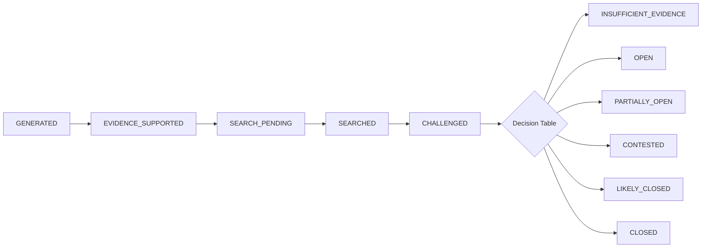

# AI / Research Architecture — Clinova Research Intelligence Platform

## 1. Provider abstraction

Per `03-system-architecture.md` AD-2, three model-facing ports, introduced when a real second implementation exists:

```text
LLMProvider          — chat(), chat_json(), vision() -> Result[T, ErrorInfo]   [Phase 1: NVIDIA NIM]
EmbeddingProvider     — embed(texts) -> vector[]                                [Phase 3: BGE-M3, local]
RerankerProvider      — rerank(query, candidates) -> ranked[]                   [Phase 3: BGE-reranker, local]
```

`LLMProvider`'s contract is exactly the existing `Result[str, ErrorInfo]` / `LLMCallError` pattern from `utils/azure_client.py` (Stories 1.1-1.2 of the baseline) — a working, already-battle-tested design, not reinvented. Swapping the NVIDIA NIM adapter for a future `vLLM` local provider or another OpenAI-compatible/cloud provider requires zero business-logic change anywhere in `packages/research-engine`.

## 2. LLM-use discipline (brief §14, binding)

| Use LLM for | Use deterministic code / local models for |
|---|---|
| Difficult scientific extraction (ambiguous methodology/dataset language) | Simple parsing, ID matching, exact deduplication |
| Semantic gap reasoning | Metadata transformation |
| Query expansion (where synonym/terminology expansion is genuinely non-trivial) | State transitions (gap lifecycle — see §4) |
| Final relevance judgment (last-mile candidate filtering) | Versioning, quality-score arithmetic |
| Contradiction reasoning | Deterministic filtering (date ranges, provider status codes) |
| Research council reasoning | Embeddings, reranking, simple classification — **local models** (BGE-M3, BGE-reranker), not LLM calls |
| Proposal reasoning | — |

**Rule:** any new pipeline stage proposed during implementation must be checked against this table before defaulting to an LLM call. This is enforced at code-review time (per `bmad-code-review`), not automatically — recorded as a review checklist item in `09-epics-and-stories.md`.

## 3. Small specialized agents (brief §15)

Five roles only, matching (and renaming) the existing `llm_council.py` 4-model roster plus a new Gap Challenger role:

| Agent | Responsibility | Replaces / extends |
|---|---|---|
| Evidence Extractor | Extracts structured Evidence Objects (§8 of the brief) from reconciled paper text | New — Phase 2 |
| Gap Generator | Proposes candidate gaps from deterministic patterns + graph structure + semantic reasoning | Evolves `gap_detector.py` |
| Gap Challenger | Runs the adversarial validation workflow (§4 below) | Evolves `academic_search.py`'s `_assess_coverage` |
| Methodology Critic | Reviews a candidate gap's proposed methodology for soundness | New role within the existing council concept |
| Research Chair | Synthesizes council output into Proceed / Proceed with caution / Needs more evidence / Reject | Evolves `llm_council.py`'s chair model (`openai/gpt-oss-120b`) |

Every agent instance carries, as **typed, enforced configuration** (not convention):

```text
AgentConfig {
  role: string
  input_schema: JSON Schema ref (packages/research-schemas)
  output_schema: JSON Schema ref
  max_tokens: int
  max_requests: int
  max_tool_calls: int
  max_search_calls: int
  timeout_seconds: int
  allowed_tools: string[]
  model: ModelBundleRef        # see 06-versioning-lineage-architecture.md
  prompt_version: string        # see 06-versioning-lineage-architecture.md
}
```

**No agent spawns another agent** except the Research Chair, and only under a bounded, explicit uncertainty-threshold trigger (e.g., Methodology Critic confidence below a fixed threshold triggers one additional, capped Gap Challenger re-run — never an open-ended recursive fan-out). This is a hard cap, not a soft guideline, enforced by a spawn-depth counter in the agent runner.

**Consensus is reserved for high-impact decisions only** (brief §16) — specifically: final novelty validation (Gap Challenger's terminal status assignment) and Research Chair's proceed/reject recommendation. Every other stage uses a single model call, not a council.

## 4. Hybrid Gap Engine

Three combined signal sources, per PRD FR-10, none sufficient alone:

1. **Deterministic pattern library** — a versioned, code-defined (not LLM-defined) rule set evaluated against Evidence Objects and paper metadata. Starting set (medical/healthcare-AI domain): missing external validation, single-center study, limited/non-diverse population, missing demographic subgroup analysis, small sample size, no longitudinal evidence, no fairness/bias testing, missing benchmark comparison, no explainability analysis, named methodological limitation (self-reported in the paper's own Limitations section). **Expanded draft (2026-08-21):** `domain-patterns-healthcare-ai.md` — 20 additional patterns across study validity, population/fairness, comparison/interpretability, deployment, and data/reproducibility, grounded in TRIPOD+AI/PROBAST/CONSORT-AI. Explicitly marked draft-needs-expert-review — produced as a best-effort starting set at the user's request rather than blocking on an unavailable clinical/biostatistics reviewer; treat as the Phase 3 input to correct, not pre-validated fact. Not yet run against real papers to confirm the patterns actually fire correctly — that validation is real Phase 3 work.
2. **Graph-structural reasoning** — queries over the persisted graph (Neo4j, Phase 3) for missing expected relationships, sparse subgraph regions, conflicting relationship claims, and untested combinations (e.g., an intervention studied in population A and a dataset studied in population B, never studied together).
3. **Semantic reasoning** — a single Gap Generator LLM call per candidate area, scoped narrowly (per §2's discipline), used only where the first two sources surface a candidate area that needs conceptual interpretation to state as a gap.

Every candidate gap emitted carries which of the three sources contributed to it — this provenance is itself an Evidence Object reference (never an unsupported graph edge or unsupported claim, per PRD FR-8).

## 5. Gap Challenger — state machine (resolves PRD FR-12 / `00-analysis...` C9)

### 5.1 Lifecycle states (linear pipeline + terminal branch)



- **GENERATED** — raw candidate from the Hybrid Gap Engine (§4).
- **EVIDENCE_SUPPORTED** — passed an internal evidence-quality gate: at least one Evidence Object with `confidence ∈ {medium, high}` supports the candidate; candidates that fail this gate are not promoted (surfaced separately as low-confidence candidates, never silently discarded).
- **SEARCH_PENDING** — queued for the Gap Challenger; search not yet executed (transient — e.g., rate-limited, batched).
- **SEARCHED** — full query-planning → query-expansion → multi-provider search → dedup → rerank funnel has executed; results retrieved but not yet judged.
- **CHALLENGED** — relevance judgment and contradiction analysis have both completed against the searched results.
- Terminal status is assigned **deterministically** from `CHALLENGED` by the decision table below — never left to implicit LLM judgment.

### 5.2 Terminal status decision table

Computed from two measured inputs: **Search Coverage Score** (0-1: fraction of planned query families executed × fraction of queried providers that responded successfully — a technically-empty-but-low-coverage search never reaches this table with a "confident" verdict) and, once coverage clears the minimum bar, the challenge funnel's **relevant result count** and **contradiction count**.

| Search Coverage Score | Relevant results | Contradictions | Terminal status |
|---|---|---|---|
| < 0.6 (coverage itself insufficient — poor query construction, provider outage, vocabulary mismatch) | any | any | **`INSUFFICIENT_EVIDENCE`** |
| ≥ 0.6 | 0 | 0 | **`OPEN`** |
| ≥ 0.6 | ≥1 (adjacent/related work, none directly addressing the gap's specific claim) | 0 | **`PARTIALLY_OPEN`** |
| ≥ 0.6 | ≥1 | ≥1 (relevant results disagree with each other or with the gap's framing) | **`CONTESTED`** |
| ≥ 0.6 | ≥2 independent, directly-relevant, converging results, high confidence | 0 | **`LIKELY_CLOSED`** |
| ≥ 0.6 | ≥3 independent, directly-relevant, converging, high-confidence results, no disagreement | 0 | **`CLOSED`** |

**Binding rule (this is the literal fix for Problem D / brief's explicit instruction):** a Search Coverage Score below 0.6 **always** routes to `INSUFFICIENT_EVIDENCE`, regardless of result count — a technically-empty search can never resolve to `OPEN` without first clearing the coverage bar. The 0.6 threshold, and the exact Search Coverage Score formula's weighting, are Phase 3 implementation parameters tuned against the Clinova Benchmark (`07-evaluation-architecture.md`) — recorded here as the binding *shape* of the rule, not a permanently fixed constant.

### 5.3 Every stage is inspectable
Per PRD FR-13, the full funnel (query families used, providers queried, candidate count, post-dedup count, post-rerank count, relevant count, contradicting count) is recorded per gap challenge and rendered on the Gap Challenger UI screen (`02-ux-specification.md` §5, row 8) — never collapsed into a black-box verdict.

## 6. Determinism / bounded-nondeterminism envelope (brief §16)

| Control | Application |
|---|---|
| Low temperature | Applied per agent role where determinism matters more than creative variance (extraction, relevance judgment); higher temperature reserved for genuinely generative tasks (proposal drafting) — tuned per `AgentConfig.model`. |
| Fixed seed | Applied where the provider supports it (tracked in the model bundle version). |
| Versioned system prompts | Every prompt has a `prompt_version` (`06-versioning-lineage-architecture.md`), bumped on any wording/logic change — same convention as the existing `stage_logic_version`. |
| Structured JSON-schema outputs | All agent outputs validate against `packages/research-schemas` before being accepted — malformed output is a `Failure`, never silently coerced. |
| Deterministic pre/post-processing & sort ordering | All list outputs (search results, evidence lists, gap rankings) sorted by an explicit, documented key — never dict/set iteration order. |
| Immutable corpus/search snapshots | A run's input corpus and search results are versioned and frozen at run start — re-running against "the same" project after new papers are added is a new corpus version, not a silent mutation. |
| Model/prompt/tool version tracking | Captured in every Run Manifest (`06-versioning-lineage-architecture.md`). |
| Semantic-input-hash caching | Extends the existing `content_hash:domain_hash:stage_logic_version` cache-key convention unchanged. |
| Retry policy distinguishing transient failure from reasoning variation | A retried call due to a transient API failure (`LLMCallError`) is not conflated with two different-but-valid reasoning outputs from two separate calls — retries reuse the same call, they do not silently accept a second, different answer as if it were the first. |

**Explicitly not done:** running five LLMs for every task. Consensus (the Research Council) is reserved for the two high-impact decisions named in §3.

### 6.1 Repeatability Score
Computed by running the frozen Clinova Benchmark (`07-evaluation-architecture.md`) N times (N fixed per evaluation run, e.g. 3) against one pipeline version, and measuring:
- **Gap overlap** — Jaccard similarity of the generated-candidate-gap sets across runs.
- **Ranking correlation** — Spearman correlation of opportunity-score rankings across runs.
- **Confidence drift** — mean absolute difference in per-gap confidence scores across runs.
- **Claim/proposal stability** — proportion of Evidence Object claims and proposal recommendations that are textually/semantically unchanged across runs.

The Repeatability Score is reported per pipeline version (not a one-time number) and is a **champion/challenger promotion input** (`07-evaluation-architecture.md`), not a fixed pass/fail gate on its own — the product should be able to say "this pipeline version is 92% repeatable on the benchmark" rather than pretending full determinism.

## 7. Token / compute budget (brief §48)

- Every `AgentConfig` (§3) enforces `max_tokens`/`max_requests`/`max_search_calls`/`timeout_seconds` — a runaway agent cannot silently consume unbounded budget.
- Hierarchical evidence retrieval (Evidence Objects + graph context, not full paper text) is the default context-construction strategy for every LLM call from Phase 2 onward — full-paper-to-LLM calls are a Phase 0-1 baseline behavior being explicitly retired, not a target state.
- Token usage is recorded per run/stage/agent/model in the Run Manifest (`06-versioning-lineage-architecture.md`), enabling the Compare screen's token-consumption metric (`02-ux-specification.md` §5, row 13).
