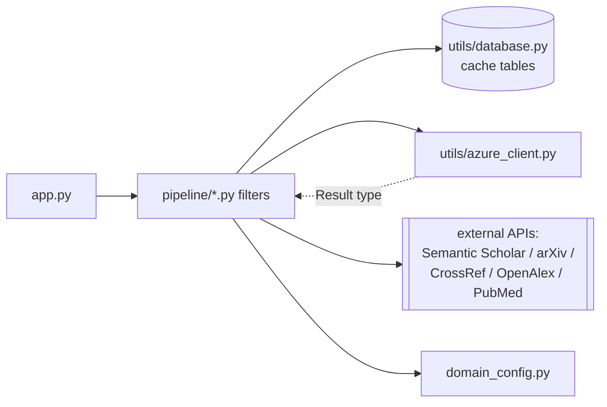
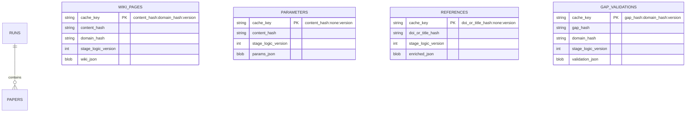

# Architecture Spine — ResGap Pipeline Soundness & Caching Architecture

## Design Paradigm

**Pipes-and-Filters** [ADOPTED] — ratified from the existing codebase, not introduced new. `app.py` sequences independent, dict-in/dict-out filter stages under `pipeline/*.py` (parse → extract-references → compile-wiki → build-graph → detect-gaps → extract-params → simulate → generate-proposals/docs). `utils/*.py` and `domain_config.py` are shared infrastructure the filters draw on, not filters themselves.

This run adds one capability to that paradigm: filters that call an LLM or external API become **cache-checked filters** — each checks a content-addressed cache before doing real work, and writes its result back afterward. The pipe/filter shape doesn't change; a cache-hit filter just short-circuits its own body.

## Invariants & Rules



### AD-1 — Dependency direction

- **Binds:** all
- **Prevents:** `utils/*.py` (shared cache/client infrastructure) ever depending back on the filters it serves, which would create a circular import the moment a filter needs a new cache/client capability
- **Rule:** `pipeline/*.py` may import `utils/*.py`, `domain_config.py`, and other `pipeline/*.py` modules (already true today — e.g. `wiki_compiler.py` imports `pdf_parser`/`page_index`, `multi_run.py` imports `llm_council`). `utils/*.py` must never import from `pipeline/*.py` or `app.py`. [ADOPTED] — the `utils/*.py`-never-imports-`pipeline` direction is verified true in the existing codebase today; this fixes only that direction as a rule, not filter-to-filter imports (which already happen and are fine).

### AD-2 — Cache-aside on every LLM/API-calling filter

- **Binds:** `wiki_compiler.compile_wiki_page`, `param_extractor.extract_parameters` (per-paper call), `reference_extractor.enrich_reference`, `academic_search._assess_coverage` (and any future filter that calls an LLM or external API per-item)
- **Prevents:** re-spending LLM tokens or external-API calls on a paper, reference, gap, or parameter-set already resolved in a prior run
- **Rule:** each such filter checks its cache table in `utils/database.py` before doing real work, and writes the result back only after a genuine `Success`-path result (see AD-4). A filter that catches `LLMCallError` and falls back to a degraded/deterministic result (e.g. `graph_builder._fallback_graph_from_wiki`) must never cache that fallback result as if it were the real thing — a transient failure must not get permanently frozen into the cache. Cache lookup is not optional plumbing — a filter that calls an LLM/API without a cache check first violates this spine.

### AD-3 — Cache key composition

- **Binds:** `wiki_pages`, `parameters`, `references`, `gap_validations` cache tables
- **Prevents:** (a) a paper/gap cached under one domain selection (e.g. "Healthcare AI") silently serving stale-domain content under a different domain selection, for stages whose output is domain-conditioned; (b) a future prompt or query-builder change silently continuing to serve results computed under the old logic forever; (c) two independent implementers producing different hashes for identical content because the hash algorithm or serialization order wasn't pinned
- **Rule:** every cache key is the colon-joined string `content_hash:domain_hash:stage_logic_version` (domain_hash is the literal text `none` when omitted), using SHA-256 throughout. `content_hash` = SHA-256 of the paper full text (`wiki_pages`, `parameters`), the DOI/arXiv-id/normalized-title (`references`), or the gap title+description (`gap_validations`). `domain_hash` = SHA-256 of `json.dumps(relevant domain_config subset, sort_keys=True)`, included **only** for stages whose output is domain-conditioned — `wiki_pages` and `gap_validations` (both call `inject_domain_into_*`/use `domain_config` in their prompts) — and omitted (`'none'`) for `parameters` and `references`, neither of which take `domain_config` today. `stage_logic_version` is a small integer constant bumped whenever that stage's prompt or query-construction logic changes.

### AD-4 — Explicit Result type at the LLM boundary

- **Binds:** `utils/azure_client.py` (`chat`, `chat_json`, `vision` — all three, including `vision()`, which is consumed unchecked in `pdf_parser.py` today and has the identical sentinel-string bug)
- **Prevents:** a downstream filter treating a failed LLM call's error string as real content — the exact cause of `graph_builder.py` being unable to distinguish "the LLM found no entities" from "the API call itself failed"
- **Rule:** `chat()`, `chat_json()`, and `vision()` all return `Result[str, ErrorInfo]` (`Success(value)` / `Failure(error)`), never a plain string that doubles as an error sentinel. Every direct caller of any of these three methods unwraps immediately: on `Success`, proceed as today; on `Failure`, raise a project-specific exception (`LLMCallError`) rather than passing the error string further downstream. This fix is scoped to the client boundary only — pipeline stages continue to look like normal Python with try/except, not `Result`-typed all the way through.

### AD-5 — Resilient external-API calls

- **Binds:** `academic_search._search_semantic_scholar`, `academic_search._search_arxiv`, all lookup functions in `reference_extractor.py` (`_ss_by_doi`, `_crossref_by_doi`, etc.)
- **Prevents:** a transient rate-limit (429) or network blip being silently reported as "no relevant papers found" / "no metadata available" — the confirmed, live-reproduced cause of every gap in the sample report showing zero validation coverage
- **Rule:** every such call must explicitly raise on a non-2xx response (e.g. `resp.raise_for_status()`) instead of the current pattern of checking `if resp.status_code == 200` and silently falling through to `return []` on anything else — `tenacity`'s retry decorator only retries on a raised exception, so a call that never raises on 429 gives `tenacity` nothing to catch. Once raising is in place, wrap the call in `tenacity` retry with exponential backoff + jitter before finally falling back to an empty result. Semantic Scholar calls carry an API key (stored the same way the existing NVIDIA NIM key is handled — user-supplied, never hardcoded) rather than calling unauthenticated.

### AD-6 — Confidence-gated, properly-pooled simulation

- **Binds:** `param_extractor.py` output consumed by `simulation_engine.py`
- **Prevents:** an LLM-invented number from vague language (e.g. "majority" → 60) being sampled into a Monte Carlo run with the same weight as a real measured statistic; risk ratios from different papers being multiplied together as if independently measured on the same population
- **Rule:** `simulation_engine._sample()` only accepts parameters where `confidence in {"medium", "high"}`; `confidence == "low"` parameters are excluded from simulation and surfaced separately as "excluded, low-confidence estimates." Cross-paper combination of odds/relative/hazard ratios goes through `pipeline/pooling.py`'s random-effects (DerSimonian-Laird) pooling function, hand-implemented on `scipy`/`numpy` primitives (neither library ships DerSimonian-Laird pooling built in) — direct multiplication of independently-sampled ratios from different papers is no longer permitted.

### AD-7 — Correct arXiv query construction

- **Binds:** `academic_search._search_arxiv`
- **Prevents:** the confirmed, live-reproduced bug where an unquoted multi-word `all:` field query is parsed by arXiv as an OR across individual words, returning topically irrelevant results (e.g. a Mendelian-Randomization/ADHD query returning a paper on CMB polarisation) — silently degrading gap-validation quality even when arXiv is reachable
- **Rule:** `_search_arxiv`'s query must group the gap's search terms as a quoted phrase (or explicit `AND`-joined terms) rather than passing raw space-separated words under a bare `all:` prefix, so arXiv matches papers actually about the combined topic rather than any paper containing any one word.

## Consistency Conventions

| Concern | Convention |
| --- | --- |
| Naming (entities, files, interfaces, events) | New module `pipeline/pooling.py`. New tables `wiki_pages`, `references`, `gap_validations` alongside existing `runs`/`papers` in `utils/database.py`. Exception class `LLMCallError` in `utils/azure_client.py`. |
| Data & formats (ids, dates, error shapes, envelopes) | `Result[str, ErrorInfo]` = `Success(value: str)` \| `Failure(error: ErrorInfo)`; `ErrorInfo` carries `kind` (`timeout`\|`rate_limit`\|`api_error`) and `detail`. Cache keys are always the colon-joined string `content_hash:domain_hash:stage_logic_version` (SHA-256 hex digests; `domain_hash` literal `none` where not applicable — see AD-3). JSON parsing keeps the existing 3-strategy fallback (strip fences → trailing-comma cleanup → regex-extract outermost brackets) already used across `wiki_compiler.py`/`graph_builder.py`/`llm_council.py`/`academic_search.py` — unchanged by this spine. |
| State & cross-cutting (mutation, errors, logging, config, auth) | Cache writes happen only after a successful (non-`Failure`) result — never cache a failure. `# B<N> fix:` inline changelog comment convention (existing project-context.md convention) continues to apply to fixes made under this spine. API keys (NVIDIA NIM, Semantic Scholar) are user-supplied at runtime, never hardcoded or committed. |

## Stack

| Name | Version |
| --- | --- |
| tenacity | 9.1.4 (verified current on PyPI, requires Python >=3.10) |
| scipy | >=1.12.0 (existing pin — `pipeline/pooling.py`'s random-effects pooling is hand-implemented on scipy/numpy primitives; scipy has no built-in DerSimonian-Laird function, so no new package is added but the math itself is new code, not a library call) |
| numpy | >=1.26.0 (existing pin) |

## Structural Seed

```text
Research_Gap_Analyzer/
  pipeline/
    pooling.py          # NEW — random-effects (DerSimonian-Laird) pooling, used by simulation_engine.py
    simulation_engine.py  # _sample() gains confidence gate; combined_risk uses pooling.py instead of direct multiplication
    academic_search.py   # search calls raise on non-2xx + gain tenacity retry + SS API key; _search_arxiv query fixed to phrase/AND match
    reference_extractor.py  # lookup calls gain tenacity retry
    wiki_compiler.py     # compile_wiki_page checks wiki_pages cache before calling chat_json
    param_extractor.py   # extract_parameters checks parameters cache before calling chat_json (per paper)
    graph_builder.py     # catches LLMCallError distinctly from "LLM returned empty entities"; never caches the fallback graph
  utils/
    database.py          # gains wiki_pages, parameters, references, gap_validations tables
    azure_client.py       # chat()/chat_json()/vision() return Result[str, ErrorInfo]; adds LLMCallError
```



## Deferred

- **Cache growth/retention policy for `wiki_pages`/`parameters`/`references`/`gap_validations`** — no eviction or size cap is defined; at current single-user, research-tool scale unbounded growth is not a practical concern, but revisit if the SQLite file grows large enough to affect startup/query time.
- **Circuit breaker (`pybreaker`) on external API calls** — retry-with-backoff (AD-5) is judged sufficient at current single-user scale; revisit if sustained (not transient) rate-limit exhaustion becomes common.
- **Result-type propagation beyond the LLM boundary** (Option B from coaching) — deferred; AD-4 scopes the fix to `azure_client.py` only. Revisit if a similar "can't tell empty from failed" bug surfaces at another boundary (e.g. the academic-search layer) where a project-specific exception isn't enough.
- **Concurrent/multi-user access to the SQLite cache** — out of scope; ResGap is a single-user Streamlit session today. Revisit if concurrent runs are ever supported (would affect AD-2's cache-write-after-success rule and may require moving off SQLite).
- **Deployment & operations envelope** — unchanged by this spine; ResGap remains a locally-run/Codespaces Streamlit app with no new infra, provider, or ops surface introduced by these fixes.
